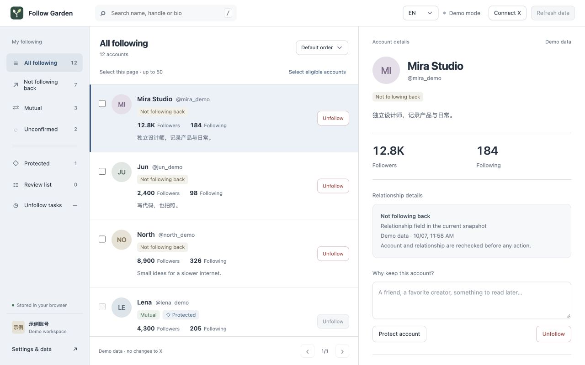

# Follow Garden

[English](README.md) · [简体中文](README.zh-CN.md)

A free, open-source browser extension for reviewing your X following. Browse relationships, protect accounts you want to keep, and confirm single or selected batch unfollows.

[Website](https://iruochen.github.io/follow-garden/) · [Privacy policy](https://iruochen.github.io/follow-garden/privacy.html) · [Report a bug](https://github.com/iruochen/follow-garden/issues)



## Features

- Following and followers in a three-column workspace, with search, sorting and pagination.
- Mutual follows, accounts not following back, and unconfirmed relationships.
- A protection list with notes and direct removal controls.
- One refresh loads following and followers in sequence, with live progress and cancellation.
- Single or selected batch unfollow review, confirmation, pause and per-account results.
- English and Simplified Chinese, local storage, CSV export and data clearing.
- Free X web-session reads, or optional TwitterAPI.io with your own key and provider charges.

Protected and unconfirmed accounts are excluded from unfollow tasks. Incomplete follower data cannot prove that an account does not follow you back. X interfaces may change or rate-limit requests; uncertain write results are not automatically replayed.

## Install

Version 0.1.0 was submitted to the Chrome Web Store on October 8, 2026 and is pending review. It will publish automatically after approval. Until a store listing is available:

1. Download the extension ZIP from [Releases](https://github.com/iruochen/follow-garden/releases) and extract it, or clone this repository.
2. Open `chrome://extensions` (or `brave://extensions`) and enable Developer mode.
3. Choose **Load unpacked** and select the extracted extension folder, or the repository's `extension/` directory.
4. Open Follow Garden from the toolbar. The fictional demo works without an X account.
5. For live data, choose **Connect X**, grant optional X access, and click **Refresh data**. An existing signed-in X tab is reused when available.

Live unfollows require a separate confirmation. Use your own account and verify results on X. Reading has been tested in Brave; real unfollow and background recovery still require acceptance testing across environments.

## Read modes and privacy

**X web (free)** uses your signed-in X tab. Authentication stays briefly in background memory; you do not paste an X password or token. Refresh reads following and follower profiles. Follower requests do not require simulated scrolling.

**TwitterAPI.io** requires your own key and username. Refresh loads all following and follower profiles and incurs provider charges; profile IDs are reused for relationship comparison without an extra ID-list request. Keys use browser-session storage by default, or local storage if you choose Remember. No X cookies are sent to the provider. Loading settings does not make paid requests.

Snapshots, notes and task history stay in your browser. No developer server, analytics or ads are included. See the [privacy policy](docs/privacy.md).

## Development

Requires Node.js 20+ and Python 3.10+. No third-party production dependencies or build step.

```sh
npm test
npm run check
npm run package
npm run preview
```

Preview: `http://127.0.0.1:4173/extension/ui/index.html` (demo only). Website: `http://127.0.0.1:4173/site/`. The package command creates `dist/follow-garden-0.1.0.zip`.

Checks cover synthetic scenarios and local assets. They do not certify availability of live X endpoints or successful real unfollow operations.

## Project

| Directory | Purpose |
| --- | --- |
| `extension/` | Manifest V3 extension, service worker and bilingual UI |
| `tests/` | Synthetic regression tests |
| `site/` | Bilingual static website and privacy policy |
| `store-assets/` | Icons and screenshots using fictional accounts |
| `scripts/` | Local validation and packaging |
| `docs/` | Public architecture and privacy documentation |

[Architecture](docs/architecture.md) · [Contributing](CONTRIBUTING.md) · [Security](SECURITY.md) · [Code of conduct](CODE_OF_CONDUCT.md)

## License

[MIT](LICENSE). Follow Garden is independent and is not affiliated with X Corp.
