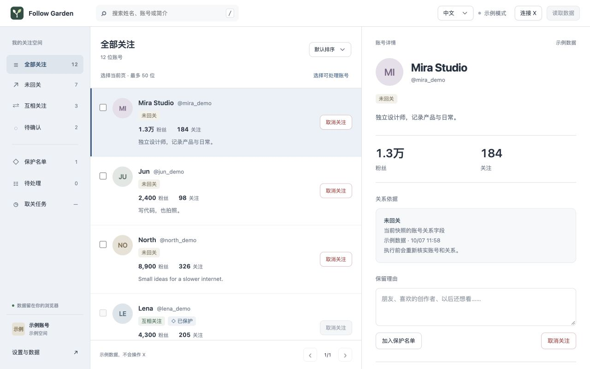

# Follow Garden · 关注花园

[English](README.md) · [简体中文](README.zh-CN.md)

免费开源的浏览器扩展，帮助你查看 X 关注关系、保护重要账号，并在复核后确认单个或批量取消关注。

[产品网站](https://iruochen.github.io/follow-garden/) · [隐私政策](https://iruochen.github.io/follow-garden/privacy.html) · [反馈问题](https://github.com/iruochen/follow-garden/issues)



## 功能

- 三栏界面查看关注和关注者，支持搜索、排序和分页。
- 区分互关、未回关与待确认关系。
- 保护名单、保留备注、行内移除保护。
- 一次依次读取全部关注与关注者，逐页展示进度，可取消。
- 单个或已选批量取关的复核、确认、暂停及逐项结果。
- 中英文切换、本地存储、CSV 导出和清除数据。
- 免费 X 网页会话读取，或可选 TwitterAPI.io 自备 Key 读取，费用由供应商收取。

保护和未知关系不会进入取关任务；不完整粉丝集不能证明未回关。X 接口可能变化或限流，结果未知的写请求不会自动重发。

## 安装

0.1.0 已于 2026 年 10 月 8 日提交 Chrome 商店审核，通过后自动公开发布。当前仍在审核中，尚未提供正式商店安装链接。

1. 从 [Releases](https://github.com/iruochen/follow-garden/releases) 下载扩展 ZIP 并解压，或克隆仓库。
2. 打开 `chrome://extensions` 或 `brave://extensions`，启用开发者模式。
3. 选择“加载已解压的扩展程序”，选中解压目录或仓库的 `extension/`。
4. 从工具栏打开关注花园，默认合成示例无需 X 账号。
5. 读取真实资料时，点击“连接 X”并授予可选站点权限，再点击“读取数据”。优先复用已有登录的 X 标签。

真实取关需单独确认，请用自己的账号并在 X 核实结果。读取已在 Brave 验证；真实取关与后台恢复仍需在不同环境中验收。

## 读取方式与隐私

**X 网页（免费）**复用已登录标签，会话认证仅短暂保留于后台内存，不要求粘贴 X 密码或 Token。顶部读取依次获取关注和关注者；关注者请求不依赖模拟滚动。

**TwitterAPI.io**需自备 Key 和用户名。顶部读取全部关注及关注者资料，按供应商规则收费；资料 ID 直接用于关系比对，不额外请求同一 ID 列表。Key 默认保留在浏览器会话，勾选记住后保存在本地；不向供应商发送 X Cookie，打开设置不产生付费请求。

快照、备注和任务保存在本机浏览器。没有开发者服务器、分析服务或广告。详见 [隐私政策](docs/privacy.zh-CN.md)。

## 开发

需要 Node.js 20+、Python 3.10+。无第三方生产依赖，无构建步骤。

```sh
npm test
npm run check
npm run package
npm run preview
```

扩展示例：`http://127.0.0.1:4173/extension/ui/index.html`；网站：`http://127.0.0.1:4173/site/`。打包输出 `dist/follow-garden-0.1.0.zip`。

测试使用合成数据及本地素材检查，不证明实时接口长期可用或真实取关成功。

[架构](docs/architecture.zh-CN.md) · [贡献指南](CONTRIBUTING.zh-CN.md) · [安全政策](SECURITY.zh-CN.md) · [行为准则](CODE_OF_CONDUCT.zh-CN.md)

## 许可

[MIT](LICENSE)。关注花园是独立产品，与 X Corp. 不存在隶属关系。
